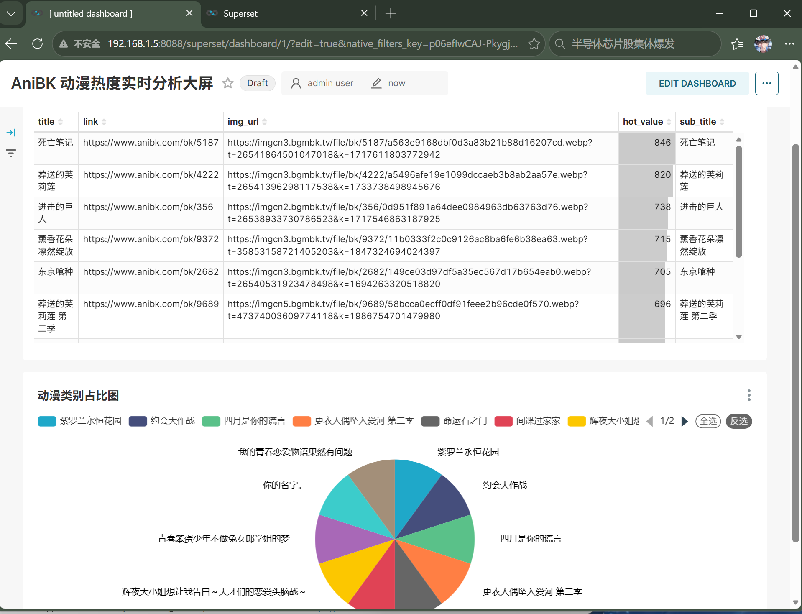
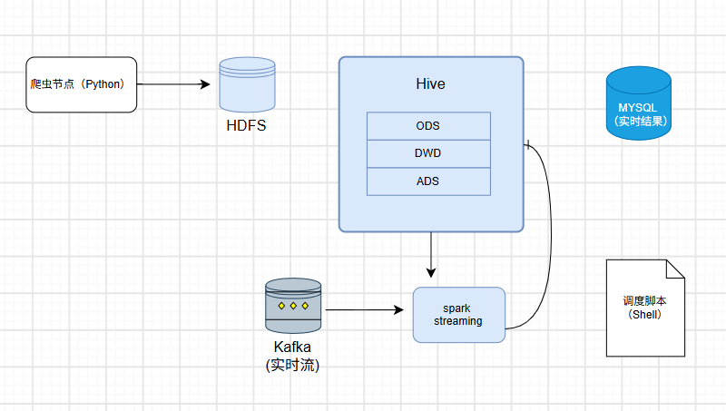

# 📊 AniBK 动漫数据离线/实时双链路数据仓库 (BigData Platform)

## 🖼️ 项目成果展示

## 📝 项目简介
本项目是一个基于开源大数据生态构建的**离线+实时**双链路数据仓库平台，用于采集、清洗、计算并可视化动漫热度数据，最终为业务侧提供数据大屏看板。

## 🛠️ 技术栈
- **数据采集**：Python (Requests/BeautifulSoup), Kafka
- **数据存储**：HDFS, Hive, MySQL
- **数据计算**：Spark (PySpark/Scala), Spark Streaming
- **调度与运维**：Shell Script, Docker, Linux
- **数据可视化**：Apache Superset

## 🏗️ 项目架构图
  <!-- 这里记得放你之前画的那张图 -->

## 🔥 核心功能与亮点
1. **数仓分层建模**：基于 Hive 构建 ODS、DWD、DWS、ADS 四层数仓架构，采用分区表和复杂数据类型。
2. **离线 ETL 开发**：使用 PySpark 与 Scala 开发 ETL 脚本，实现明细数据清洗与 `EXPLODE` 行列转换，结果以 Parquet 格式高效落盘。
3. **实时流处理**：基于 Kafka 3.x 集群，通过 Spark Streaming 消费实时数据流，利用 `foreachBatch` 与 Checkpoint 机制确保数据精准一次性写入 MySQL。
4. **数据可视化**：通过 Docker 部署 Superset，连接 MySQL 实时展示图表。

## 📂 目录说明
- `python/`：Python 爬虫与 ETL 清洗脚本
- `scala/`：Scala 版 Spark 计算作业
- `shell/`：集群一键启停与日志清理脚本
- `sql/`：Hive 建表与数据分析语句
- `day33_superset.md`：数据大屏搭建手册
- `journal.md`：30天学习打卡与踩坑日记（包含 Spark on YARN、DataNode 崩溃等 10+ 生产级报错复盘）

## 🧗 遇到的困难与解决（Troubleshooting）
*详细踩坑记录见 `journal.md`。核心亮点：*
- **集群危机**：独立排查并修复 DataNode ClusterID 冲突导致的服务宕机。
- **YARN 调优**：解决 Spark 提交 YARN 时的内存超限强杀问题（调整 memoryOverhead）。
- **环境固化**：通过 `docker commit` 固化 Superset 容器，彻底解决依赖缺失与重启数据丢失问题。
